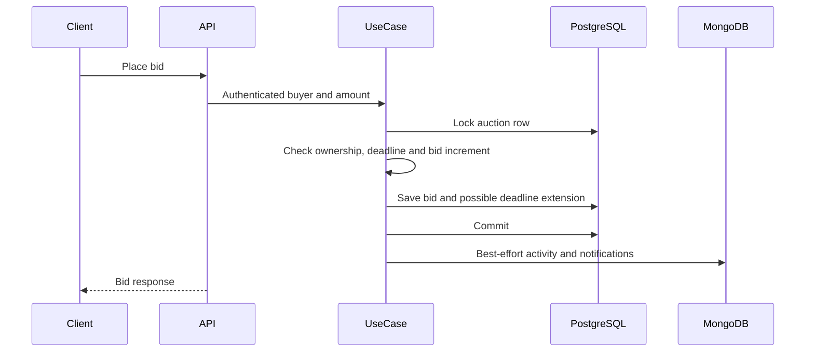

# Architecture and patterns

## Hexagonal architecture

The domain contains Java models, business policies and input/output ports. Application services
coordinate use cases. Infrastructure implements persistence, HTTP, authentication, storage and
external providers. ArchUnit rejects domain dependencies on frameworks or outer layers and application
dependencies on infrastructure.

Spring service and transaction annotations in the application layer are a deliberate pragmatic choice.
JPA entities and MongoDB documents never become API response objects.

## Design patterns

| Pattern | Participants | Purpose |
|---|---|---|
| Adapter | Repository adapters, Stripe, R2, AI providers | Implement domain ports using external technologies |
| Strategy | `AiProviderPort`, `GroqAiAdapter`, `OpenAiAdapter`, `AiStrategySelector` | Swap valuation providers and provide fallback |
| Template Method | `AbstractAiAdapter` and its provider subclasses | Share request execution and parsing workflow while delegating provider details |
| Builder | `AuctionBuilder` | Assemble an auction and validate price/date combinations |
| Observer | `AuctionClosedListenerPort`, `AuctionClosedNotifier` | Allow auction closing to notify independent listeners |
| Factory | `OrderFactory` | Construct orders with consistent pricing, currency and artwork snapshots |
| Repository | Output repository ports and persistence adapters | Isolate use cases from database APIs |

`OrderFactory` is a simple factory, not GoF Factory Method or Abstract Factory. Hexagonal architecture
is an architectural style. Dependency injection supplies collaborators; it does not make every class a
separate design pattern. The unused auction facade, redundant observer alias and fixed AI provider
factory were removed because they did not simplify an actual flow.

## Auction flow

Creating an auction locks the artwork. A partial unique index prevents two active auctions for the
same artwork. Artwork edits also lock that row and reject active auctions and non-expired orders.
Bids, cancellation, buy-now and automatic closing lock the auction. Orders have a unique auction ID.

## Payment flow

1. Lock the order, validate buyer and deadline, snapshot delivery details and persist `PROCESSING`
   with the payment method, start time and unique reference.
2. Commit before calling the provider, using the reference as its idempotency key.
3. Lock the order again and apply the result only if the attempt still matches.
4. Save the transaction ID. A stale response cannot overwrite a newer attempt or fulfillment state.

An interrupted request keeps its original attempt. Processing orders remain reserved. Retrying after
23 hours is blocked to avoid relying indefinitely on a provider's idempotency retention period.
Unpaid `PENDING` and `FAILED` orders expire after 48 hours. Shipping and delivery also lock the order.

A domain model with guarded transitions is sufficient here; adding one State class per status would
increase complexity without a current benefit. A durable outbox and shared rate limiter remain useful
extensions when delivery guarantees or multiple API instances become requirements.
